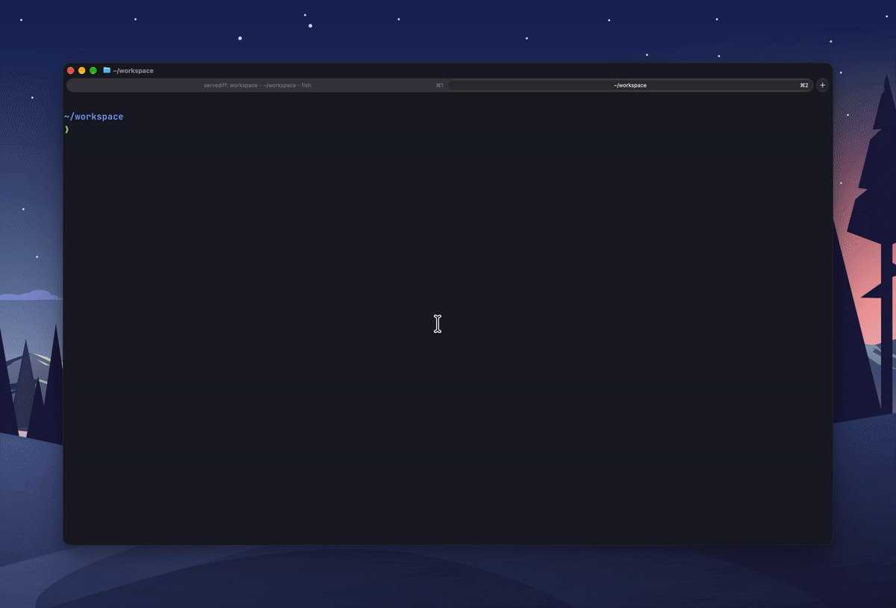

# gitsy

gitsy is a tiny CLI that scans a directory for git repositories and linked worktrees, automatically fetches from upstream, and optionally fast-forwards local branches with `--fast-forward`. It displays status in a nice TUI so you can see what needs attention.



## Install

```bash
brew install flexdinesh/tap/gitsy
```

```bash
go install github.com/flexdinesh/gitsy/cmd/gitsy@latest
```

## Usage

```bash
# Show all discovered repositories under the current directory.
gitsy

# Fast-forward repositories that can safely update without conflicts.
gitsy --fast-forward

# Print a status summary and exit; add --verbose for a per-repo report.
gitsy status

# Fast-forward safely without opening the TUI, print a summary, and exit.
gitsy --dir ~/workspace sync

# Fetch all remotes without updating local branches.
gitsy --dir ~/workspace fetch

# Delete all merged linked worktrees after confirming; -y skips the prompt.
gitsy --dir ~/workspace worktree delete-merged
gitsy --dir ~/workspace worktree delete-merged -y

# Scan repository directories up to a specific nested depth.
gitsy --max-depth 5

# Start scanning from a specific directory instead of the current directory.
gitsy --dir ~/workspace

# Scan multiple directories and include their repositories' linked worktrees.
gitsy --dir ~/workspace/org-one --dir ~/workspace/org-two

# Skip fetching upstream changes and use local status only.
gitsy --no-fetch

# Print warnings for skipped repos and failed git commands.
gitsy --verbose

# Show help.
gitsy --help

# Show the installed version.
gitsy --version
```

Use `Tab` to switch **Repositories** / **Worktrees**, `↑/↓` or `j/k` to
select rows, `f` to toggle file details,
`PgUp/PgDn` or the mouse wheel to scroll, and `q` to quit. Wide terminals
show context for the selected repository. Colors adapt to light and dark themes.

By default, each invocation runs `git fetch --all` for fresh upstream state;
nothing is cached between invocations. Within a run, main checkouts and linked
worktrees sharing a Git common directory share one fetch when safe. Separate
clones fetch independently, even with the same remote URL. Repositories with
worktree-specific configuration, conditional includes, submodules, relative
remote URLs, URL rewrites, custom fetch hooks, or custom transport/credential
commands fetch per checkout to preserve their existing behavior. Checkout-relative TLS, cookie,
validation, and bundle paths also disable sharing. Status and sync remain
independent for each checkout.

`--fast-forward` and `gitsy sync` always fetch; `--fast-forward` ignores `--no-fetch`. Only
clean branches with an upstream, commits behind, and no commits ahead can
fast-forward. If any remote
fails to fetch, sync is skipped for that checkout, including failures from
unrelated remotes. Available local status is shown as stale with
`sync skipped: fetch failed`.

With `--dir`, only the supplied directories are scanned. `--max-depth` applies
to each directory; linked worktrees are included wherever they live. Relative
paths resolve from the current directory.

Repositories are grouped by scan directory, in the order `--dir` is supplied.
Without `--dir`, the current directory is the group. Groups stay expanded;
navigation skips directory headers. Repositories found through overlapping
directories appear in each group, while status and sync run once per unique
checkout. Fetches are shared across eligible linked worktrees as described above.
Linked worktrees appear in each group that discovers them.

The **Worktrees** tab lists linked worktrees from the same scan, including those
outside the supplied directories. Main checkouts remain in **Repositories**.
Press `x` on a worktree to delete it. Deletion keeps the branch and
removes the row from both tabs. Inspection must finish first; main, locked, and
current-directory worktrees remain protected. Like Git, deletion removes ignored
files without warning. Changed or untracked files and submodules trigger a
warning; review the path, then press `y` to force deletion and discard those
files, or `Esc`/`n` to cancel. Press `X` to force delete without confirmation.
Every attempt checks fresh Git state.
Left/right and Shift+Tab also switch views.

Repository labels use the origin remote's repository name, falling back to the
directory name when unavailable. Full paths appear in the sidebar.

## Commands

Commands run without the TUI and exit. Options such as `--dir`, `--max-depth`,
`--no-fetch`, `--base`, and `--verbose` may appear before or after the command.

| Command | Does | Prints |
| --- | --- | --- |
| `gitsy status` | Fetches (unless `--no-fetch`) and reads status | `gitsy · 6 repos · 1 behind · 2 changed` |
| `gitsy sync` | Fetches and fast-forwards safe repos | `Synced 2 of 6 repos. 3 up to date, 1 failed.` |
| `gitsy fetch` | Fetches without touching local branches | `Fetched 5 of 6 repos. 1 failed.` |
| `gitsy worktree delete-merged` | Force deletes merged linked worktrees; keeps branches | `Deleted 2 merged worktrees. Branches kept.` |

Each command prints one summary line on stdout and one line per failed
repository on stderr, such as `gitsy: api (/ws/api): fetch failed: auth`.
`--verbose` adds the grouped per-repo report (or per-worktree deletion results)
and detailed Git warnings. Output contains no filenames or terminal control
sequences. Dirty, behind, diverged, and sync-skipped repositories are normal
results. An empty workspace succeeds.

`worktree delete-merged` lists merged worktrees and asks `[y/N]` before
deleting. Without a terminal it refuses unless `-y` is given. Each worktree is
rechecked right before deletion; main, locked, and current-directory worktrees
stay protected.

Exit codes:

| Code | Meaning |
| --- | --- |
| `0` | Success, including dirty, behind, or skipped repos |
| `1` | A fetch, status, sync, or delete failed; deletion was declined; or scanning failed |
| `2` | Invalid usage, or confirmation required without a terminal |
| `130` | Interrupted |

## Development

Project commands run through mise:

```bash
mise trust
mise run setup
mise run check
mise run build
```

See [docs/development.md](docs/development.md).

## Releases

Stable releases are published manually from `main`; development versions install
directly from `main`. See [docs/release.md](docs/release.md).
