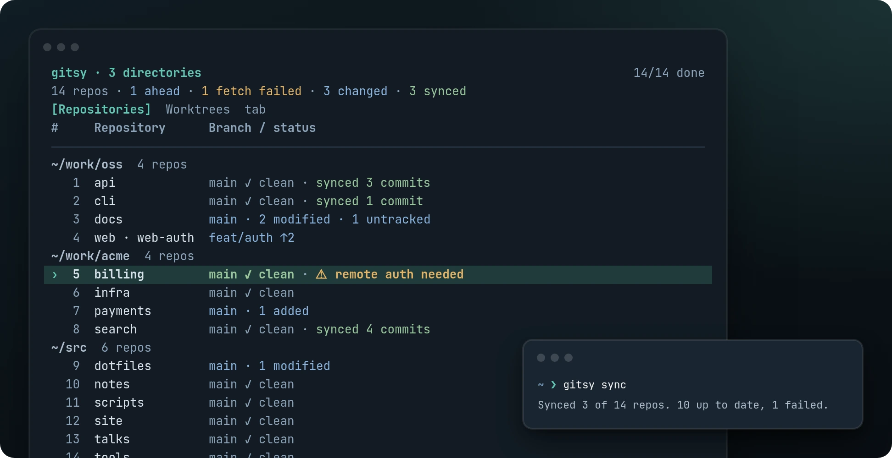

# gitsy

[](https://github.com/flexdinesh/gitsy/releases) [](go.mod) [](LICENSE)

**Every repo in your workspace, fetched, checked, and safely fast-forwarded. One command.**



A workspace with dozens of clones and linked worktrees drifts stale fast, and keeping it current means a loop of `cd`, `git fetch`, `git status`, and `git pull`. gitsy is a tiny CLI that scans a directory for Git repositories and linked worktrees, fetches every remote, and fast-forwards the branches that can safely update. It shows the result in one compact TUI, so you only look at what needs attention.

## Features

- **Finds everything:** repositories in nested directories and their linked worktrees, across multiple `--path` roots, grouped by scan directory.
- **Always fresh:** runs `git fetch --all` on every run; linked worktrees share one fetch when safe.
- **Safe fast-forward only:** clean branches with an upstream, commits behind, and none ahead. Updates use `git merge --ff-only`; gitsy never creates merge commits, rebases, or stashes.
- **Explains failures:** shows the reason, such as `⚠ remote auth needed`, and suggests a fix.
- **Worktree cleanup:** the Worktrees tab deletes worktrees with `x`/`X`, and `D` or `gitsy worktree delete-merged` removes merged ones. Branches are kept.
- **Scriptable:** `gitsy sync` and `gitsy worktree delete-merged` print one-line summaries and use stable exit codes.
- **Terminal-native:** keyboard and mouse, colors that adapt to light and dark themes, small terminals, and `NO_COLOR`.

## Install

```bash
brew install flexdinesh/tap/gitsy
```

```bash
go install github.com/flexdinesh/gitsy/cmd/gitsy@latest
```

## Quick start

```bash
# Scan the current directory, fetch, fast-forward safe repos, and open the TUI.
gitsy

# Scan several directories, grouped in the order given.
gitsy --path ~/workspace/org-one --path ~/workspace/org-two

# Fast-forward without the TUI, print a summary, and exit.
gitsy --path ~/workspace sync

# Delete all merged linked worktrees after confirming; -y skips the prompt.
gitsy --path ~/workspace worktree delete-merged
```

## Keys

| Key | Action |
| --- | --- |
| `Tab`, `Shift+Tab`, `←`/`→` | Switch **Repositories** / **Worktrees** |
| `↑`/`↓`, `j`/`k` | Move selection |
| `g`/`G`, `Home`/`End` | Jump to first / last row |
| `f` | Toggle file details |
| `PgUp`/`PgDn`, mouse wheel | Scroll |
| `u`/`d`, `Ctrl+U`/`Ctrl+D` | Scroll half a page |
| `x` | Worktrees tab: delete the selected worktree; confirms before discarding files |
| `X` | Worktrees tab: force delete the selected worktree without confirmation |
| `D` | Worktrees tab: delete all merged worktrees; confirms first |
| `y` | Confirm a deletion prompt |
| `Esc`, `n` | Cancel a deletion prompt |
| `q`, `Ctrl+C` | Quit |

Wide terminals show context for the selected repository in a side rail.

## Commands

Without a command, gitsy opens the TUI. Commands run without the TUI and exit. Options may appear before or after the command.

| Command | Does | Prints |
| --- | --- | --- |
| `gitsy sync` | Fetches and fast-forwards safe repos | `Synced 2 of 6 repos. 3 up to date, 1 failed.` |
| `gitsy worktree delete-merged` | Force deletes merged linked worktrees; keeps branches | `Deleted 2 merged worktrees. Branches kept.` |

Options:

| Option | Meaning |
| --- | --- |
| `--path <path>` | Scan `<path>` instead of the current directory (repeatable) |
| `--max-depth <n>` | Scan repository directories up to `n` nested levels (default: 3) |
| `--base <branch>` | Default branch for merged worktrees (default: `gitsy.base` config, then `origin/HEAD`) |
| `--verbose` | Print per-repo details and warnings for skipped repos and failed Git commands |
| `-y`, `--yes` | `worktree delete-merged`: delete without confirming |
| `--help` | Show help |
| `--version` | Show the installed version |

### Exit codes

| Code | Meaning |
| --- | --- |
| `0` | Success, including dirty, behind, or skipped repos |
| `1` | A fetch, status, sync, or delete failed; deletion was declined; or scanning failed |
| `2` | Invalid usage, or confirmation required without a terminal |
| `130` | Interrupted |

## How it stays safe

- Only clean branches with an upstream, commits behind, and no commits ahead fast-forward.
- If any remote fails to fetch, sync is skipped for that checkout, including failures from unrelated remotes.
- Status and sync run independently for each checkout, once per unique checkout.
- Main, locked, and current-directory worktrees are never deleted.
- In the TUI, deletion waits for inspection to finish. Every attempt checks fresh Git state.
- Deleting a worktree with changed or untracked files or submodules asks first, unless forced with `X` or `-y`.
- Deletion always keeps the branch.

## Details

<details>
<summary>Fetching and fetch sharing</summary>

Each invocation runs `git fetch --all` for fresh upstream state; nothing is cached between invocations. Within a run, main checkouts and linked worktrees sharing a Git common directory share one fetch when safe. Separate clones fetch independently, even with the same remote URL.

Repositories with any of these fetch per checkout to preserve their existing behavior:

- worktree-specific configuration
- conditional includes
- submodules
- relative remote URLs
- URL rewrites
- custom fetch hooks
- custom transport or credential commands
- checkout-relative TLS, cookie, validation, or bundle paths

Status and sync remain independent for each checkout.

</details>

<details>
<summary>Fetch failures and remote state</summary>

The TUI and `gitsy sync` fast-forward after fetching. When a fetch fails, available local status is shown with the fetch reason, such as `main ✓ clean · ⚠ remote auth needed`, and the context rail suggests a fix. Repositories without remotes show `local only`; branches without an upstream show `no upstream`.

</details>

<details>
<summary>Scan paths, depth, and grouping</summary>

With `--path`, only the supplied directories are scanned. Relative paths resolve from the current directory. `--max-depth` applies to each directory; linked worktrees are included wherever they live.

Repositories are grouped by scan directory, in the order `--path` is supplied. Without `--path`, the current directory is the group. Groups stay expanded; navigation skips directory headers.

Repositories found through overlapping directories appear in each group, while status and sync run once per unique checkout. Linked worktrees appear in each group that discovers them.

</details>

<details>
<summary>Worktree deletion</summary>

The **Worktrees** tab lists linked worktrees from the same scan, including those outside the supplied directories. Main checkouts remain in **Repositories**.

Press `x` on a worktree to delete it. Deletion keeps the branch and removes the row from both tabs. Inspection must finish first; main, locked, and current-directory worktrees remain protected. Like Git, deletion removes ignored files without warning. Changed or untracked files and submodules trigger a warning: review the path, then press `y` to force deletion and discard those files, or `Esc`/`n` to cancel. Press `X` to force delete without confirmation. Every attempt checks fresh Git state.

`worktree delete-merged` lists merged worktrees and asks `[y/N]` before deleting. Without a terminal it refuses unless `-y` is given. Each worktree is rechecked right before deletion; main, locked, and current-directory worktrees stay protected.

</details>

<details>
<summary>Command output</summary>

Each command prints one summary line on stdout and one line per failed repository on stderr, such as `gitsy: api (/ws/api): remote auth needed`, followed by a `hint:` line when gitsy can suggest a fix. `--verbose` adds the grouped per-repo report (or per-worktree deletion results) and detailed Git warnings. Output contains no filenames or terminal control sequences.

Dirty, behind, diverged, and sync-skipped repositories are normal results. An empty workspace succeeds.

</details>

<details>
<summary>Repository labels</summary>

Repository labels use the origin remote's repository name, falling back to the directory name when unavailable. Full paths appear in the sidebar.

</details>

## Development

Project commands run through mise:

```bash
mise trust
mise run setup
mise run check
mise run build
```

See [docs/development.md](docs/development.md).

## Releases

Stable releases are published manually from `main`; development versions install
directly from `main`. See [docs/release.md](docs/release.md).

## License

MIT, see [LICENSE](LICENSE).
